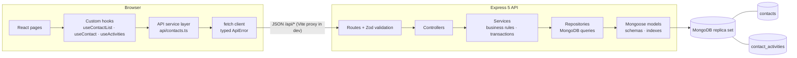

# CRM Contact Workspace

A full-stack contact workspace for the HighLevel SDE2/SDE3 take-home: browse, search, filter, sort, and page through contacts; edit them safely when several people work on the same record; manage tags one at a time or in bulk; and see each contact's recent activity.

Everything that matters for correctness runs on the server and is backed by the database: search, filtering, sorting, and pagination are MongoDB queries designed for large collections; email uniqueness is a database index; stale updates are rejected by an atomic version check; and every change is recorded in the same transaction as the change itself.

**At a glance**

- 8 REST endpoints · 300 seeded demo contacts · measured on 100,000 contacts
- **358 automated tests**: 219 backend, 124 frontend, 15 end-to-end (Playwright, including a two-browser conflict test and phone-layout checks)
- Works on desktop, tablet, and phone screens

## Contents

[Tech stack](#tech-stack) · [Architecture](#architecture) · [Folder structure](#folder-structure) · [Getting started](#getting-started) · [Environment variables](#environment-variables) · [Scripts](#scripts) · [API](#api) · [Data model and indexes](#data-model-and-indexes) · [Concurrency](#concurrency-stale-updates) · [Tags, activity, and bulk operations](#tags-activity-and-bulk-operations) · [Testing](#testing) · [Production-scale considerations](#production-scale-considerations) · [Known limitations](#known-limitations) · [AI usage](#ai-usage-disclosure) · [Further documentation](#further-documentation)

## Tech stack

| Layer | Choice | Why |
|---|---|---|
| Frontend | React 19, TypeScript (strict), Vite 8, React Router 8 | Requested stack; Vite gives a fast dev server and a same-origin `/api` proxy |
| Frontend state | React hooks, the URL, `useReducer` — **no Redux, no React Query** | State is mostly server data and page-local UI state; one custom data hook handles cancellation and stale responses ([ADR-010](docs/adr.md#adr-010-frontend-state-management)) |
| Backend | Node.js 24, Express 5, TypeScript (strict) | Express 5 forwards async errors to the error handler |
| Validation | Zod 4 (backend and frontend) | Typed parsing of untrusted input |
| Database | MongoDB 8 via Mongoose 9 — a **replica set** (MongoDB Atlas) | Transactions keep each change and its activity record consistent ([ADR-002](docs/adr.md#adr-002-mongodb-replica-set-and-transactions)) |
| Tests | Vitest, Supertest, mongodb-memory-server, React Testing Library, Playwright, axe-core | Real MongoDB (in memory) for backend tests; real browser for end-to-end |

No Redis, Kafka, Elasticsearch, Docker, or other infrastructure: nothing in the requirements needed it. [Production-scale considerations](#production-scale-considerations) explains when it would.

## Architecture



- **Backend layers** depend in one direction: routes → controllers → services → repositories → models. Controllers only translate HTTP; business rules and transactions live in services; all database access lives in repositories.
- **Validation happens once, at the edge**: a `validated()` wrapper parses params, query, and body with strict Zod schemas and hands typed input to the controller (Express 5 makes `req.query` read-only, so the usual "overwrite the request" middleware isn't possible).
- **Errors** have one shape everywhere: `{ "error": { "code", "message", "details"? } }`. Clients switch on `code`.
- **Frontend**: components never call `fetch` directly. A typed service layer wraps every endpoint; custom hooks add cancellation, stale-response protection, and refetching. List state (search, filters, sort, page) lives in the URL, so refresh, the back button, and shared links all work.

Full design: [docs/01-architecture.md](docs/01-architecture.md). Decisions and their alternatives: [docs/adr.md](docs/adr.md).

## Folder structure

```
.
├── backend/
│   ├── src/
│   │   ├── app.ts                    Express app (no server, no DB) — used by tests
│   │   ├── server.ts                 Startup, graceful shutdown
│   │   ├── config/env.ts             Zod-validated environment
│   │   ├── db/connection.ts          Connects; refuses a non-replica-set database
│   │   ├── modules/
│   │   │   ├── contacts/             model · schemas · query builder · repository ·
│   │   │   │                         service · tag service · controllers · routes
│   │   │   ├── activities/           model · repository · service · controller
│   │   │   └── health/
│   │   ├── shared/                   errors · logger · transaction helper ·
│   │   │                             validation · middleware
│   │   └── scripts/                  seed.ts · explain.ts (query plans)
│   └── test/                         Integration and unit tests (Vitest + Supertest)
├── frontend/
│   ├── src/
│   │   ├── api/                      fetch client · typed service functions · types
│   │   ├── hooks/                    useApiRequest · useDebouncedValue · useSelection ·
│   │   │                             useMediaQuery · resource hooks
│   │   ├── features/contacts/list/   list page, filters, table/cards, pagination, bulk tagging
│   │   ├── features/contacts/detail/ detail page, edit form, conflict banner, tags, timeline
│   │   └── components/               buttons, fields, chips, loading/error/empty states
│   └── e2e/                          Playwright: journeys, accessibility, keyboard, phone layout
└── docs/                             requirements · architecture · ADRs · performance ·
                                      testing · code review
```

## Getting started

### Prerequisites

- **Node.js 22 or newer** (developed on Node 24; see `.nvmrc`)
- **A MongoDB replica set.** Transactions require one, and the backend refuses to start without it. Either:
  - **MongoDB Atlas (used during development).** Create a free M0 cluster at [cloud.mongodb.com](https://cloud.mongodb.com). Under *Database Access*, add a database user with a password; under *Network Access*, add your IP address; under *Connect → Drivers*, copy the `mongodb+srv://…` connection string. Atlas clusters are always replica sets.
  - **A local `mongod` started as a single-node replica set**, e.g. `mongod --replSet rs0 --dbpath <folder>`, then once `mongosh --eval "rs.initiate()"`, and use `mongodb://localhost:27017/crm_dev?replicaSet=rs0`. *(This option is supported by the code but was not tried on the author's machine.)*

### Install, seed, run

```bash
# 1. Backend
cd backend
npm ci
cp .env.example .env          # then set MONGODB_URI — keep "/crm_dev" before the "?"
npm run seed                  # 300 deterministic demo contacts
npm run dev                   # http://localhost:4000

# 2. Frontend (second terminal)
cd frontend
npm ci
npm run dev                   # http://localhost:5173
```

Open **http://localhost:5173**. The Vite dev server forwards `/api` to the backend, so no CORS setup is needed.

Health check: `curl http://localhost:4000/api/health` → `{"status":"ok","db":"up"}`.

**Production build (locally):** `cd backend && npm run build && NODE_ENV=production npm start`, then `cd frontend && npm run build && npm run preview` (http://localhost:4173, proxies `/api` to the backend).

### Seed data

`npm run seed` deletes all contacts and activities in the target database and inserts 300 deterministic contacts. It is designed to exercise the features: names that share prefixes (Ann, Anna, Annette — and Joanne, which should *not* match "ann"), accented names (José, Zoë, Müller), three identical "John Smith" contacts and two contacts with the same creation time (to test sort tie-breaking), messy input emails (normalized on the way in), and contacts missing email, phone, company, or last name.

Safety: the seed **refuses to run** with `NODE_ENV=production` or against any database whose name doesn't end in `_dev`, `_test`, or `_e2e`. `npm run seed -- --count=100000` creates a large data set for performance checks (use a separate `*_test` database).

### Try the conflict scenario

Open one contact in two browser tabs. Change the company in tab B and save. Change the phone in tab A and save: A gets a conflict banner showing B's change, A's draft is kept, and **Keep my changes** merges A's edits on top of B's version.

## Environment variables

| Variable | Where | Required | Default | Purpose |
|---|---|---|---|---|
| `MONGODB_URI` | backend | **yes** | — | Replica-set connection string, including the database name (e.g. `/crm_dev`) |
| `PORT` | backend | no | `4000` | API port |
| `NODE_ENV` | backend | no | `development` | `development` / `test` / `production` (production disables automatic index builds and the seed) |
| `API_PROXY_TARGET` | frontend | no | `http://localhost:4000` | Where the Vite dev/preview server forwards `/api` |
| `VITE_API_BASE_URL` | frontend | no | (same origin) | Absolute API origin for builds served without the proxy |
| `E2E_MONGODB_URI` | e2e tests | no | `MONGODB_URI` with the database renamed to `crm_e2e` | Database for end-to-end tests |

Templates: `backend/.env.example`, `frontend/.env.example`. `.env` files are git-ignored.

## Scripts

| Backend (`cd backend`) | |
|---|---|
| `npm run dev` | API with reload on change |
| `npm run build` / `npm start` | Compile to `dist/` / run the compiled server |
| `npm run seed` | Reset and seed the database (guarded, see above) |
| `npm run explain` | Print MongoDB query plans for every list query shape |
| `npm test` | Unit and integration tests (in-memory MongoDB replica set; no setup needed) |
| `npm run typecheck` · `lint` · `format:check` | Static checks |

| Frontend (`cd frontend`) | |
|---|---|
| `npm run dev` | Dev server with the `/api` proxy |
| `npm run build` / `npm run preview` | Typecheck + production build / serve the build |
| `npm test` | Unit and component tests (API mocked) |
| `npm run test:e2e` | Playwright end-to-end tests (run `npx playwright install chromium` once) |
| `npm run typecheck` · `lint` · `format:check` | Static checks |

## API

Base path `/api`. Bodies are JSON. Contacts are returned as:

```json
{
  "id": "6ad4…",
  "firstName": "Ann", "lastName": "Lee",
  "email": "ann.lee@example.com", "phone": null, "company": "Acme Corp",
  "tags": ["vip", "lead"],
  "version": 3,
  "createdAt": "2026-01-01T10:00:00.000Z", "updatedAt": "2026-03-02T08:15:00.000Z"
}
```

Optional fields that have no value are `null`. Internal search fields are never returned.

| Endpoint | Purpose | Notes |
|---|---|---|
| `GET /api/health` | Liveness + database reachability | 503 when the database is down |
| `GET /api/contacts` | List | Query: `q` (≥ 2 chars, prefix match on first/last/full name, email, phone digits), `company` (exact, case-insensitive), `tags` (`vip,lead` or repeated; contact must have **all**), `sortBy` = `createdAt` \| `name`, `sortOrder` = `asc` \| `desc`, `page` (≥ 1), `limit` (1–100, default 20). Returns `{ data, pagination: { page, limit, total, totalPages } }`. Unknown parameters → 400 |
| `GET /api/contacts/:id` | One contact | 404 unknown, 400 malformed id |
| `PATCH /api/contacts/:id` | Update profile fields | Body: `{ version, firstName?, lastName?, email?, phone?, company? }`. `null` or `""` clears an optional field. Returns the updated contact (version + 1); a request with no real change returns 200 with the version unchanged |
| `POST /api/contacts/:id/tags` | Add a tag | Body `{ tag }`. Returns `{ contact, changed }`; `changed: false` if it was already there |
| `DELETE /api/contacts/:id/tags/:tag` | Remove a tag | Returns `{ contact, changed }`; `changed: false` if it wasn't there |
| `POST /api/contacts/bulk-tags` | Add a tag to many contacts | Body `{ contactIds (1–500), tag }`. Returns `{ tag, requested, modified, alreadyTagged, skippedTagLimit, notFound }` |
| `GET /api/contacts/:id/activities` | Recent activity, newest first | Query `limit` (1–50, default 20) |

**Error codes**

| Status | Code | When |
|---|---|---|
| 400 | `VALIDATION_ERROR` | Invalid input; `details.fields` maps fields to messages (body fields unprefixed, e.g. `email`; query fields as `query.limit`) |
| 400 | `INVALID_ID` · `INVALID_JSON` | Malformed id in the URL · unparseable body |
| 404 | `NOT_FOUND` · `ROUTE_NOT_FOUND` | Unknown contact · unknown endpoint |
| 409 | `VERSION_CONFLICT` | Stale `version`; `details.current` is the contact as it is now |
| 409 | `DUPLICATE_EMAIL` | Email used by another contact; `details.field = "email"` |
| 413 | `PAYLOAD_TOO_LARGE` | Body over 100 kb |
| 422 | `TAG_LIMIT_EXCEEDED` | New tag on a contact that already has 50 |
| 503 | `QUERY_TIMEOUT` | A query ran longer than 5 s |
| 500 | `INTERNAL_ERROR` | Unexpected; details only in server logs (with a request ID) |

## Data model and indexes

**`contacts`**

| Field | Rules |
|---|---|
| `firstName` | required, 1–100 chars |
| `lastName`, `company` | optional, ≤ 100 / ≤ 200 chars |
| `email` | optional; trimmed and lowercased; **unique when present** |
| `phone` | optional, as typed; must contain 7–15 digits |
| `tags` | lowercase, trimmed, unique, 1–40 chars each, ≤ 50 per contact |
| `version` | integer from 1, +1 on every profile change (optimistic concurrency) |
| `createdAt`, `updatedAt` | managed by Mongoose |
| `fullNameLower`, `firstNameLower`, `lastNameLower`, `companyLower`, `phoneDigits` | derived lowercase/digit copies for indexed search and sorting; recomputed on every write; never returned |

Empty optional values are **left out of the document** (never stored as `""` or `null`), which is what lets the email index allow any number of contacts without an email.

**`contact_activities`** — `contactId`, `type` (`CONTACT_UPDATED` · `TAG_ADDED` · `TAG_REMOVED`), `createdAt`, and `details`: changed fields with before/after values, or the tag (plus a `bulkOperationId` for bulk changes). Kept in its own collection because history grows without limit, while contact documents must stay small.

**Indexes** (equality fields first, then sort fields; every sort ends with `_id` so ordering is stable)

| Index | Serves |
|---|---|
| `{ email }` **unique, partial** (only where email is a string) | Uniqueness; email prefix search |
| `{ createdAt: -1, _id: -1 }` | Default list, date sort |
| `{ lastNameLower, firstNameLower, _id }` | Name sort; last-name search |
| `{ fullNameLower }` | First-name / "first last" search |
| `{ phoneDigits }` partial | Phone search |
| `{ tags, createdAt, _id }` · `{ tags, lastNameLower, firstNameLower, _id }` | Tag filter with each sort |
| `{ companyLower, createdAt, _id }` · `{ companyLower, lastNameLower, firstNameLower, _id }` | Company filter with each sort |
| `contact_activities { contactId, createdAt: -1, _id: -1 }` | Recent activity per contact |

Measured on 100,000 contacts, no list query does a collection scan, and every browse/filter page reads exactly 20 index entries to return 20 rows. That measurement also found a real bug — rare searches were scanning the whole collection because a regex can't prove it satisfies a *partial* index — fixed by adding `$type: "string"` to those branches (100,000 keys read → 13). Details: [docs/performance.md](docs/performance.md).

## Concurrency (stale updates)

**Scenario:** User A and User B open the same contact at version 1. B saves (version 2). A then saves with version 1.

1. Every `PATCH` carries the `version` the client loaded.
2. The service reads the contact (404 if missing; 409 straight away if already stale) and diffs the input against it — a request with no real change returns without writing.
3. In a transaction, one atomic operation does the check and the write:
   ```js
   findOneAndUpdate({ _id, version: expected }, { $set: changes, $inc: { version: 1 } })
   ```
   Two requests holding the same version can't both match: the first changes the version, so the second finds nothing. If nothing matched, a lookup decides between **404** (deleted) and **409 `VERSION_CONFLICT`** (stale), and the 409 includes the current contact.
4. The `CONTACT_UPDATED` activity is inserted in the same transaction.

The early version check in step 2 is only an optimization: with it removed, all tests still pass; with `version` removed from the write filter, the concurrent-update tests fail. Duplicate emails are prevented the same way — by the unique index, not by a "check then write" that would race.

**In the UI:** a 409 shows a banner listing what the other person changed and where both changed the same field. The user's draft is never discarded. **Keep my changes** does a three-way merge — fields the user edited keep the user's value, all other fields take the newer server value, and the next save is checked against the newer version — so the other person's edits can't be silently undone. **Use their version** discards the draft.

## Tags, activity, and bulk operations

- **Tags** are normalized (`" VIP  Customer "` → `"vip customer"`). Add and remove are single atomic updates whose filter states the precondition (`tags: { $ne: tag }` / `tags: tag`), so a match *means* something changed. Adding a tag the contact already has, or removing one it doesn't, returns `changed: false` and records nothing — safe to retry. Five concurrent adds of the same tag store it once and record one activity.
- **Tag changes don't bump `version`.** Set operations can't overwrite each other, and bumping the version would cause false conflicts for someone editing the contact's details at the same time ([ADR-007](docs/adr.md#adr-007-tags)).
- **Activity is recorded only for real changes**, always in the same transaction as the change, so history can't drift from the data (rollback is tested by forcing the activity write to fail).
- **Bulk tagging** (up to 500 contacts) runs in **one transaction**: it reads the selected contacts, sorts them into *eligible / already tagged / at the 50-tag limit / not found*, tags the eligible ones, and records one `TAG_ADDED` per changed contact with a shared `bulkOperationId`. Missing or already-tagged contacts are reported, not treated as errors; a real failure rolls back the whole batch, so retrying is safe. If another request changes one of these contacts meanwhile, MongoDB reports a write conflict and the batch is retried from the start.

## Testing

| Suite | Command | Count |
|---|---|---:|
| Backend unit + integration (real MongoDB in memory, replica set) | `cd backend && npm test` | 219 |
| Frontend unit + component (React Testing Library, API mocked) | `cd frontend && npm test` | 124 |
| End-to-end (Playwright: desktop Chrome + an emulated Pixel 7) | `cd frontend && npm run test:e2e` | 15 |

Highlights:

- **Concurrency is tested with concurrent requests**, not just sequential ones: 2 and 10 writers on the same version, a change landing between the read and the write, concurrent duplicate emails, bulk tagging racing single tag adds.
- **Mutation checks**: each key guarantee was deliberately broken to confirm a test fails (10 checks, listed in [docs/testing.md](docs/testing.md)). Two of them exposed tests that passed for the wrong reason, which were then fixed.
- **End-to-end tests** start their own servers on separate ports and use their own database (`crm_e2e`), re-seeded before every run; they include a two-browser stale-update test, axe accessibility checks, keyboard-focus checks, and phone-layout checks.
- Every requirement from [docs/00-requirements.md](docs/00-requirements.md) is mapped to its tests in [docs/testing.md](docs/testing.md).

End-to-end tests need network access to the MongoDB deployment and, by default, use the `MONGODB_URI` in `backend/.env` with the database renamed to `crm_e2e`.

## Production-scale considerations

These are directions, not things built for this assignment; each should be driven by measurements.

**Millions of contacts**
- Profile real queries (`explain`, slow-query log, `$indexStats`) before adding indexes; drop unused ones (each index costs every write — here the indexes are already 2.6× the data size).
- With multiple accounts, put `accountId` first in every index and every query.
- Replace offset pagination with **keyset pagination** (`?after=<last sort values>`) so deep pages cost the same as the first; cap or estimate totals for broad searches.
- Shard (by `accountId`) only when one replica set can no longer hold the data or the write load.

**Millions of updates per day**
- Writes scale with index count and transaction cost; keep transactions small (they are: one contact + one activity).
- Optimistic concurrency doesn't block; conflicts surface to users, who resolve them. Tag operations are idempotent and safe to retry.
- If activity can be eventually consistent, write an outbox record in the transaction and build history (and downstream events) asynchronously; change streams can feed other systems.

**Frequent and richer search**
- Prefix search on indexed lowercase fields is fast but limited. Substring, fuzzy, typo-tolerant, or accent-insensitive search belongs in **Atlas Search or Elasticsearch**, kept in sync by change streams.
- Caching list results is rarely worth it: results are personalized by filters and change with every edit; invalidation would be the hard part.

**Many simultaneous users**
- The API is stateless, so it scales horizontally behind a load balancer; `/api/health` returns 503 when the database is unreachable so instances drop out of rotation.
- Tune the MongoDB connection pool per instance; add authentication, per-account authorization, rate limiting, and observability (request IDs are already in logs; add metrics and tracing).

## Known limitations

- **No authentication, authorization, or multi-tenancy** (out of scope); activity records don't say *who* made a change.
- **Search is prefix-only and accent-sensitive** — `ann` doesn't find "Joanne", `jose` doesn't find "José" (`jos` does). **Name sorting is by byte order**: "Müller" sorts after "Z…", and contacts without a last name sort first.
- **Search combined with company/tag filters** reads that whole subset (measured: 1,162 reads for 78 matches at 100k contacts); broad searches count every match.
- **Offset pagination** is capped at 10,000 results deep.
- **Bulk tagging** is limited to 500 explicitly selected contacts per request; "tag everyone matching this filter" would need a background job.
- **No contact creation or deletion** — the assignment covers browsing and editing; contacts come from the seed.
- **Activity history stores before/after values** (personal data) with no retention policy.
- **Production deployment** must serve the frontend and API from one origin (the API sends no CORS headers).
- **Frontend API types are hand-copied** from the backend (no shared package or OpenAPI); end-to-end tests catch drift.
- **No CI pipeline**; end-to-end tests run in Chromium only (desktop and an emulated phone, not Safari or real devices). No load testing.

## AI usage disclosure

**Tool:** Claude Code (Anthropic, Claude Opus 5.5 model), used in the Claude desktop app.

**How it was used.** I worked through the project phase by phase with Claude Code acting as a pair programmer and reviewer: turning the brief into requirements and a risk list, proposing the architecture and the decision records, writing most of the code and tests, running the test suites, checking the app in a browser, and reviewing the result. I set the order of work, made the decisions that changed the design, reviewed and approved each phase before it was committed, and can explain every part of the code.

**What I changed or rejected.**

- **I rejected the Docker setup.** The first architecture used Docker Compose to run MongoDB as a local replica set. Docker couldn't run on my machine (Windows without WSL), and rather than add that dependency I chose MongoDB Atlas, which is a replica set out of the box. I had the Docker files removed entirely and the decision record ([ADR-002](docs/adr.md#adr-002-mongodb-replica-set-and-transactions)) rewritten.
- **I caught that responsiveness had been neglected.** After the code review, I asked whether the UI worked on smaller screens. It didn't: on a phone the filters overflowed, the contact table needed sideways scrolling, and the touch targets were too small. That led to the card layout for narrow screens, larger touch targets, and automated phone-layout tests.
- **I questioned the state-management choice before accepting it.** The brief listed Redux Toolkit as an option; I asked for a proper comparison and confirmed the assignment doesn't require it before agreeing to plain React hooks ([ADR-010](docs/adr.md#adr-010-frontend-state-management)).

**How the AI's output was checked.** Nothing was accepted on the strength of a passing test alone: query plans were measured on 100,000 contacts (which found a search bug that every functional test missed), key guarantees were deliberately broken to confirm tests catch them (which exposed two tests that were passing for the wrong reason), and the UI was exercised in a real browser, including a two-tab conflict.

## Further documentation

| Document | Contents |
|---|---|
| [docs/00-requirements.md](docs/00-requirements.md) | Requirements, assumptions and defaults, acceptance criteria, risk register |
| [docs/01-architecture.md](docs/01-architecture.md) | Architecture, API contract, write paths, frontend design |
| [docs/adr.md](docs/adr.md) | 12 architecture decision records with alternatives |
| [docs/performance.md](docs/performance.md) | Query plans and index costs measured on 100k contacts |
| [docs/testing.md](docs/testing.md) | How to run tests, requirement-to-test traceability, mutation checks |
| [docs/code-review.md](docs/code-review.md) | Code review findings, fixes, and accepted limitations |
