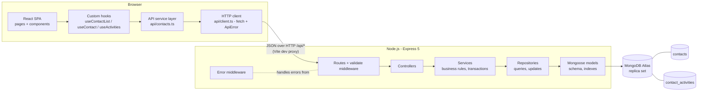
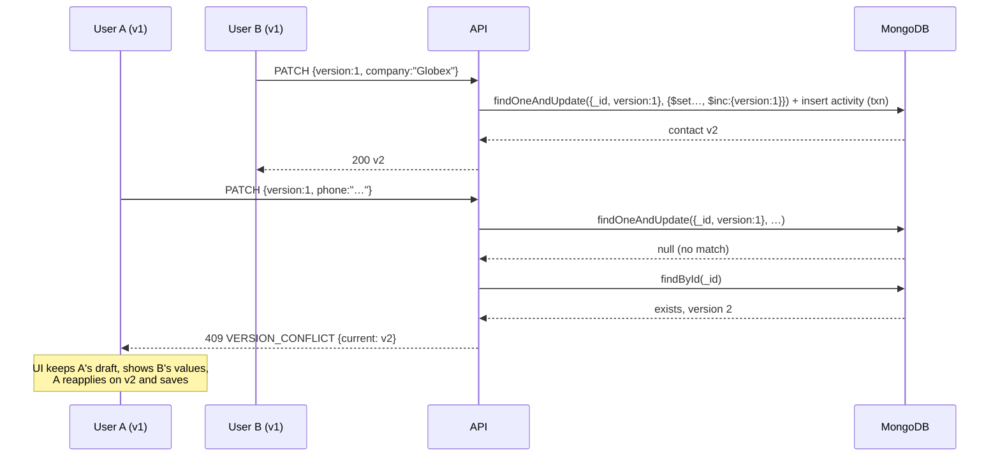

# Phase 1 — Architecture and Design

**Status:** APPROVED 2026-10-18. State management: [ADR-010](adr.md#adr-010-frontend-state-management) option A — no Redux Toolkit.
**Inputs:** [00-requirements.md](00-requirements.md) (approved), decisions in [adr.md](adr.md)

---

## 1. High-level architecture



**One process each.** The frontend is a static single-page app. The backend is one stateless Express process. MongoDB is an Atlas cluster, which is always a replica set, because transactions require one ([ADR-002](adr.md#adr-002-mongodb-replica-set-and-transactions)). Tests use an in-memory replica set instead.

**Why a Vite proxy?** In development the browser calls `/api/...` on the Vite origin and Vite forwards it to Express. Same origin means no CORS configuration, and production can put both behind one reverse proxy the same way.

---

## 2. Module boundaries and responsibilities

### Backend (dependency direction: routes → controllers → services → repositories → models)

| Layer | Owns | Must not |
|---|---|---|
| Routes | URL + method, which validation schema, which controller | Contain logic |
| Validation middleware | Parse `params`/`query`/`body` with Zod; replace them with the typed, normalized result | Touch the database |
| Controllers | Read validated input, call one service function, choose the status code, map to the response DTO | Know about Mongoose or transactions |
| Services | Business rules: normalization, diffing, version checks, "did anything change?", activity recording, transactions | Build HTTP responses |
| Repositories | All Mongoose calls; accept an optional `session` | Make business decisions |
| Models | Schema, field limits, indexes | Hold business logic (Mongoose hooks don't run on `findOneAndUpdate`, so we don't rely on them) |
| Error middleware | Map `AppError`, Zod, cast, and duplicate-key errors to one JSON shape | Leak stack traces in responses |

Code is grouped **by feature** (`modules/contacts`, `modules/activities`), with layers as files inside each module. A reviewer can find everything about contacts in one folder.

### Frontend

| Layer | Owns |
|---|---|
| `api/client.ts` | `fetch` wrapper: base URL, JSON, `AbortSignal`, turns non-2xx into a typed `ApiError { status, code, message, details }` |
| `api/contacts.ts` | One typed function per endpoint (`getContacts`, `getContactById`, `updateContact`, `addTag`, `removeTag`, `bulkAssignTag`, `getContactActivities`) |
| `hooks/` | Server-data hooks (loading/error/data, cancellation, refetch), `useDebouncedValue` |
| `features/contacts/` | Pages and feature components (list, filters, table, detail, edit form, tags, activity) |
| `components/` | Generic UI: `Spinner`, `ErrorState`, `EmptyState`, `TagChip`, `Field` |

Components never call `fetch` directly.

---

## 3. Folder structure

```
highlevel-assignment/             (existing git repo root; plays the role of crm-contact-workspace/)
├── README.md
├── docs/
├── backend/
│   ├── package.json  tsconfig.json  vitest.config.ts  .env.example
│   ├── src/
│   │   ├── app.ts                createApp(): express app, no listen (used by tests)
│   │   ├── server.ts             connect DB, listen, graceful shutdown
│   │   ├── config/env.ts         Zod-validated environment
│   │   ├── db/connection.ts
│   │   ├── shared/
│   │   │   ├── errors.ts         AppError + error codes
│   │   │   ├── middleware/       validate.ts, errorHandler.ts, requestLogger.ts
│   │   │   └── transaction.ts    withTransaction helper
│   │   ├── modules/
│   │   │   ├── contacts/
│   │   │   │   ├── contact.model.ts
│   │   │   │   ├── contact.normalize.ts   email/phone/tag/name normalization + derived fields
│   │   │   │   ├── contact.schemas.ts     Zod request schemas
│   │   │   │   ├── contact.repository.ts
│   │   │   │   ├── contact.service.ts     list, get, update
│   │   │   │   ├── tag.service.ts         add, remove, bulk
│   │   │   │   ├── contact.controller.ts
│   │   │   │   ├── contact.mapper.ts      document → API DTO
│   │   │   │   └── contact.routes.ts
│   │   │   └── activities/
│   │   │       ├── activity.model.ts
│   │   │       ├── activity.repository.ts
│   │   │       └── activity.routes.ts / controller
│   │   └── scripts/seed.ts
│   └── test/                     integration tests (Supertest + in-memory replica set)
└── frontend/
    ├── package.json  tsconfig.json  vite.config.ts  playwright.config.ts
    ├── src/
    │   ├── main.tsx  App.tsx (routes)
    │   ├── api/      client.ts  contacts.ts  types.ts
    │   ├── hooks/    useApiRequest.ts  useDebouncedValue.ts  useContactList.ts  useContact.ts  useActivities.ts
    │   ├── features/contacts/
    │   │   ├── list/     ContactsPage, ContactFilters, ContactTable, Pagination, BulkTagBar
    │   │   └── detail/   ContactDetailPage, ContactEditForm, ConflictBanner, TagEditor, ActivityTimeline
    │   └── components/
    └── e2e/                      Playwright specs
```

---

## 4. Data model

### 4.1 `contacts`

| Field | Type | Rules |
|---|---|---|
| `_id` | ObjectId | |
| `firstName` | string | required, trimmed, 1–100 |
| `lastName` | string? | trimmed, ≤ 100; **absent** when empty |
| `email` | string? | trimmed + lowercased, valid format, ≤ 254; **absent** when empty |
| `phone` | string? | trimmed as entered, ≤ 30, must contain 7–15 digits; absent when empty |
| `company` | string? | trimmed, ≤ 200; absent when empty |
| `tags` | string[] | normalized (trim, collapse spaces, lowercase), 1–40 chars each, unique, ≤ 50 items; default `[]` |
| `version` | int | starts at 1; +1 on every successful profile-field update |
| `createdAt`, `updatedAt` | Date | Mongoose `timestamps` |
| *Derived (never sent by clients, never returned):* | | |
| `fullNameLower` | string | `lower(firstName + " " + lastName)` — prefix search on first name and "first last" |
| `lastNameLower` | string? | prefix search on last name; name sort |
| `firstNameLower` | string | name sort tie-break |
| `companyLower` | string? | case-insensitive company filter |
| `phoneDigits` | string? | digits only, for phone search |

Mongoose's built-in `__v` is disabled (`versionKey: false`); see [ADR-003](adr.md#adr-003-explicit-version-field-for-optimistic-concurrency).

**Derived fields are computed by one pure function** (`deriveSearchFields`) called by the service and the seed. Mongoose `pre('save')` hooks would not run for `findOneAndUpdate`, so relying on them would leave derived fields stale after updates.

**API representation** (`ContactDTO`): `id`, `firstName`, `lastName | null`, `email | null`, `phone | null`, `company | null`, `tags`, `version`, `createdAt`, `updatedAt` (ISO strings). The database leaves empty fields *absent*; the API returns them as `null`, so the frontend always gets the same object shape.

### 4.2 `contact_activities`

| Field | Type | Notes |
|---|---|---|
| `_id` | ObjectId | |
| `contactId` | ObjectId | required |
| `type` | `CONTACT_UPDATED \| TAG_ADDED \| TAG_REMOVED` | |
| `createdAt` | Date | set by the server |
| `details.changes` | `{ field, from, to }[]` | `CONTACT_UPDATED` only; `from`/`to` are `null` when the value was empty |
| `details.tag` | string | `TAG_*` only |
| `details.bulkOperationId` | string? | set when created by bulk assignment, so related activities can be grouped |

Stored separately from contacts — [ADR-008](adr.md#adr-008-activity-history-in-its-own-collection).

### 4.3 Indexes

Rule used to design compound indexes: **E-S-R** — Equality fields first, then Sort fields, then Range fields. A prefix regex (`/^ann/`) is a *range* on the index.

| # | Collection | Index | Serves |
|---|---|---|---|
| I1 | contacts | `{ email: 1 }` **unique**, partial `{ email: { $type: "string" } }` | Email uniqueness; email prefix search |
| I2 | contacts | `{ createdAt: -1, _id: -1 }` | Default browse, sort by date |
| I3 | contacts | `{ lastNameLower: 1, firstNameLower: 1, _id: 1 }` | Sort by name; last-name prefix search |
| I4 | contacts | `{ fullNameLower: 1 }` | First-name / full-name prefix search |
| I5 | contacts | `{ phoneDigits: 1 }` partial (string) | Phone search |
| I6 | contacts | `{ tags: 1, createdAt: -1, _id: -1 }` | Tag filter + date sort (multikey) |
| I7 | contacts | `{ tags: 1, lastNameLower: 1, firstNameLower: 1, _id: 1 }` | Tag filter + name sort |
| I8 | contacts | `{ companyLower: 1, createdAt: -1, _id: -1 }` | Company filter + date sort |
| I9 | contacts | `{ companyLower: 1, lastNameLower: 1, firstNameLower: 1, _id: 1 }` | Company filter + name sort |
| I10 | contact_activities | `{ contactId: 1, createdAt: -1, _id: -1 }` | Recent activity per contact |

Index trade-off: every contact write updates up to 9 indexes, and a contact with 10 tags adds 10 entries to each tag index. That's acceptable for a read-heavy CRM list. In production we would check `$indexStats` and drop indexes that aren't used. Indexes are created at startup (`autoIndex`) in development and test; in production they would be created by a migration step.

---

## 5. Search, filter, sort, pagination

### Query shape

```
GET /api/contacts?q=ann&company=acme&tags=vip,lead&sortBy=name&sortOrder=asc&page=2&limit=20
```

Built into one MongoDB filter:

```js
{
  $and: [
    { $or: [                                   // only when q is present
        { fullNameLower: /^ann/ },             // q lowercased + regex-escaped
        { lastNameLower: /^ann/ },
        { email:         /^ann/ },
        { phoneDigits:   /^555123/ }           // only when q contains ≥ 3 digits
    ]},
    { companyLower: "acme" },                  // only when company is present
    { tags: { $all: ["vip", "lead"] } }        // only when tags are present (AND)
  ]
}
sort:  { lastNameLower: 1, firstNameLower: 1, _id: 1 }
skip:  (page - 1) * limit,   limit: limit,   maxTimeMS: 5000
```

`find` and `countDocuments` run in parallel with the same filter.

### Why this is safe

- `q` is a validated string (≤ 100 chars), escaped with a regex-escape function, and always anchored with `^`. Users never supply regex syntax → no ReDoS and no injection.
- Zod rejects anything that isn't a string, so `?company[$ne]=x` can't become a MongoDB operator.
- `sortBy` ∈ {`name`, `createdAt`}, `sortOrder` ∈ {`asc`, `desc`}; anything else → 400.

### How it performs (honest version)

| Query | Plan we expect | Comment |
|---|---|---|
| Browse, any sort | Index scan on I2/I3, no in-memory sort | Cost grows with offset, not collection size |
| Company or tag filter + sort | Index scan on I6–I9, no in-memory sort | Same |
| Search (`q`) | Each `$or` branch uses its own index (I1, I3, I4, I5); results are merged, then **sorted in memory** | Fast when the prefix is selective. A very short prefix on millions of rows matches many documents and the sort becomes expensive |

We require `q` to be at least 2 characters to limit the worst case. A dedicated search engine (Atlas Search / Elasticsearch) is the documented scale path for search. We'll back these claims with `explain("executionStats")` on a large seed before writing them in the README.

### Pagination

- Offset pagination: `page` ≥ 1, `limit` 1–100 (default 20), and `(page − 1) × limit ≤ 10,000`. Deeper pages → 400 with a message to narrow the search. Deep `skip` still walks the skipped index entries, so we bound it.
- The sort always ends with `_id`, so the order is total and pages don't overlap.
- Response: `{ data, pagination: { page, limit, total, totalPages } }`.
- Scale path: keyset pagination (`?after=<last sort values>`), and an estimated or capped count. See [ADR-006](adr.md#adr-006-offset-pagination-with-bounds).

---

## 6. REST API contract

All bodies are JSON. All errors use:

```json
{ "error": { "code": "VERSION_CONFLICT", "message": "Contact was modified by someone else", "details": { } } }
```

| Method & path | Request | Success | Errors |
|---|---|---|---|
| `GET /api/health` | — | 200 `{ status: "ok", db: "up" }` | 503 when DB is down |
| `GET /api/contacts` | query: `q`, `company`, `tags` (comma-separated), `sortBy`, `sortOrder`, `page`, `limit` | 200 `{ data: ContactDTO[], pagination }` | 400 `VALIDATION_ERROR` |
| `GET /api/contacts/:id` | — | 200 `ContactDTO` | 400 `INVALID_ID`, 404 `NOT_FOUND` |
| `PATCH /api/contacts/:id` | `{ version, firstName?, lastName?, email?, phone?, company? }` (unknown keys rejected; `null`/`""` clears an optional field) | 200 `ContactDTO` (new version) | 400, 404, 409 `VERSION_CONFLICT` (`details.current: ContactDTO`), 409 `DUPLICATE_EMAIL` (`details.field: "email"`) |
| `POST /api/contacts/:id/tags` | `{ tag }` | 200 `{ contact: ContactDTO, changed: boolean }` | 400, 404, 422 `TAG_LIMIT_EXCEEDED` |
| `DELETE /api/contacts/:id/tags/:tag` | — (tag URL-encoded) | 200 `{ contact, changed }` | 400, 404 |
| `POST /api/contacts/bulk-tags` | `{ contactIds: string[] (1–500, deduplicated), tag }` | 200 `{ tag, requested, modified, alreadyTagged, skippedTagLimit, notFound: string[] }` | 400 |
| `GET /api/contacts/:id/activities` | query: `limit` (1–50, default 20) | 200 `{ data: ActivityDTO[] }` newest first | 400, 404 |

Status code rules:
- **400** — the request itself is malformed (types, lengths, unknown fields, bad ObjectId).
- **404** — a valid ID that doesn't exist.
- **409** — valid request that conflicts with current state (stale version, email taken).
- **422** — valid request that breaks a business rule (tag limit).
- **500** — unexpected; logged with a request ID; the response never includes internals.

Tag operations return `200` with `changed: false` instead of an error when nothing changed, so retries are safe (idempotent).

---

## 7. Write paths

### 7.1 Contact update with optimistic concurrency



Service algorithm:

1. Zod validates the body; normalize values (email lowercase, empty → cleared).
2. `current = findById(id)` → **404** if missing; **409** if `current.version !== body.version` (fast path).
3. Diff normalized input against `current`. No differences → **200** with `current`, no version bump, no activity.
4. In a transaction:
   - `updated = findOneAndUpdate({ _id, version: body.version }, { $set: changes + derived fields, $unset: cleared fields, $inc: { version: 1 } }, { new: true, runValidators: true })`
   - `updated === null` → someone wrote between steps 2 and 4 → **409** with the latest contact (or 404 if it was deleted)
   - insert `CONTACT_UPDATED { changes: [{ field, from, to }] }`
5. Duplicate-key error `11000` on `email` → **409 DUPLICATE_EMAIL**.

**Key point:** step 2 is a read, but correctness never depends on it. The write in step 4 only succeeds if the version is still the one the user saw. The forbidden pattern is "read the version, then write *without* the version in the filter". Because the write requires `version: body.version`, the `from` values in the activity are exactly the values that were overwritten.

### 7.2 Add / remove tag

```js
// add: the filter itself guarantees "this is a real change"
findOneAndUpdate(
  { _id, tags: { $ne: tag }, "tags.49": { $exists: false } },   // not present, fewer than 50 tags
  { $push: { tags: tag }, $set: { updatedAt: now } },
  { new: true, session })
// matched  → insert TAG_ADDED (same transaction), changed: true
// no match → findById: missing → 404; already has tag → changed: false; 50 tags → 422

// remove
findOneAndUpdate({ _id, tags: tag }, { $pull: { tags: tag } }, …)
// matched → TAG_REMOVED; no match → 404 or changed: false
```

Putting the condition in the filter makes "did it change?" an atomic answer from the database, so two simultaneous adds of the same tag produce exactly one `TAG_ADDED`.

Tag changes do **not** bump `version` (requirements A13, [ADR-007](adr.md#adr-007-tags)).

### 7.3 Bulk tag assignment

In one transaction:
1. `eligible = find({ _id: { $in: ids }, tags: { $ne: tag }, "tags.49": { $exists: false } }, { _id: 1 })`
2. `updateMany({ _id: { $in: eligibleIds }, tags: { $ne: tag } }, { $push: { tags: tag } })`
3. `insertMany` one `TAG_ADDED` per eligible contact, sharing a `bulkOperationId`
4. Separately count `alreadyTagged`, `skippedTagLimit`, and compute `notFound`

If another request changes one of these contacts during the transaction, MongoDB reports a write conflict and `withTransaction` retries the whole unit, so the activity list always matches the contacts that were actually changed. 500 small documents is well within MongoDB's transaction limits. See [ADR-009](adr.md#adr-009-bulk-tag-assignment-in-one-transaction) — this refines requirement A20.

---

## 8. Error handling

| Source | Mapped to |
|---|---|
| `ZodError` from validation middleware | 400 `VALIDATION_ERROR`, `details.fields: { [path]: message[] }` |
| Invalid ObjectId (Zod refinement) | 400 `INVALID_ID` |
| `AppError` thrown by services | its own status + code |
| MongoDB `11000` on `email` | 409 `DUPLICATE_EMAIL` |
| Malformed JSON body | 400 `INVALID_JSON` |
| Anything else | 500 `INTERNAL_ERROR`; full error logged with request ID |

Express 5 forwards errors from `async` handlers to the error middleware automatically, so there are no `try/catch` blocks in controllers.

**Frontend:** `ApiError` carries `status` and `code`. The edit form switches on `code`:
- `VALIDATION_ERROR` → field messages
- `DUPLICATE_EMAIL` → message on the email field
- `VERSION_CONFLICT` → conflict banner
- otherwise → generic error with retry

In every case the draft stays.

---

## 9. Frontend design

### Routes

| Path | Page |
|---|---|
| `/` | redirect → `/contacts` |
| `/contacts` | List: search, filters, sort, pagination, multi-select, bulk tag |
| `/contacts/:id` | Detail: edit form, tags, activity timeline |
| `*` | Not found |

### State classification (input to ADR-010)

| State | Kind | Where it lives |
|---|---|---|
| `q`, `company`, `tags`, `sortBy`, `sortOrder`, `page` | UI state for the list query | **URL search params** (proposed) |
| Search box text before debounce | UI | `useState` in the filter component |
| Selected contact IDs | UI | `useState<Set<string>>` in the list page |
| Bulk dialog open / tag input | UI | `useState` |
| Contact list page + total | Server data | `useContactList(params)` hook |
| Contact detail | Server data | `useContact(id)` hook; replaced by mutation responses |
| Activity list | Server data | `useActivities(id)` hook; refetched after mutations |
| Edit draft, field errors, conflict | Form state | `useReducer` in `ContactEditForm` |

### Server-data hook (sketch of the contract, implemented in Phase 9)

```ts
type RequestState<T> =
  | { status: "loading"; data?: T }          // data = previous result, kept to avoid flicker
  | { status: "success"; data: T }
  | { status: "error"; error: ApiError; data?: T };

function useApiRequest<T>(fn: (signal: AbortSignal) => Promise<T>, deps: unknown[]):
  RequestState<T> & { refetch: () => void }
```

- Each run creates an `AbortController`; the cleanup aborts it. This handles unmounting, Strict Mode's double effect run, and a newer request replacing an older one.
- Aborted requests are ignored, so a slow old response can never overwrite a newer one.

### Conflict UX (three-way: base, mine, theirs)

The form remembers the **base** (the server contact the draft started from). On 409 it receives **theirs** (`details.current`). The banner lists fields where theirs ≠ base. Two actions:
- **Keep my changes** — the draft stays and its version moves to theirs' version; the user reviews and saves again.
- **Use their version** — reset the draft to theirs.

The form never re-applies anything silently.

---

## 10. Testing strategy

| Level | Tooling | Scope | Data isolation |
|---|---|---|---|
| Backend unit | Vitest | Normalization, regex escape, query builder, diffing | Pure functions |
| Backend integration | Vitest + Supertest + `mongodb-memory-server` **replica set** | Every endpoint, including concurrent cases with `Promise.all` | One in-memory replica set per test file; collections cleared in `beforeEach`; indexes synced in `beforeAll` |
| Frontend component | Vitest + React Testing Library + jsdom | States, validation, conflict handling, debounce/race | The `api/contacts` module is mocked with `vi.mock`; fake timers for debounce |
| End-to-end | Playwright (Chromium) | Main journey + two-tab conflict | Separate `crm_e2e` database, re-seeded before the run |

The concurrency tests are the most important part: they show that the guarantees come from the database, not from timing luck.

---

## 11. Production-scale notes (summary; full text goes in the README)

- **Millions of contacts:** add `accountId` as the first field of every index when multi-tenant; keyset pagination; capped or estimated counts; measure with `explain` and slow-query logs before adding indexes; shard by `accountId` only when one replica set can't hold the data or the writes.
- **Many updates:** each index costs write time — audit unused indexes; OCC conflicts are retried by the user, not the server; tag operations are idempotent; activity writes can move to an outbox + async worker if eventual consistency is acceptable.
- **Frequent search:** prefix search hits indexes; substring/fuzzy/typo-tolerant search belongs in Atlas Search or Elasticsearch fed by change streams.
- **Many users:** stateless API → horizontal scaling behind a load balancer; tune the Mongoose connection pool; add auth, per-account authorization, rate limits, request IDs, metrics, and tracing.
